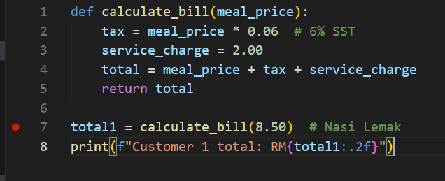
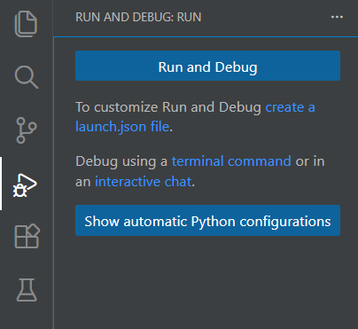
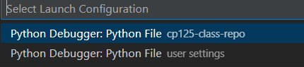
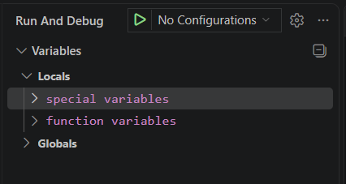
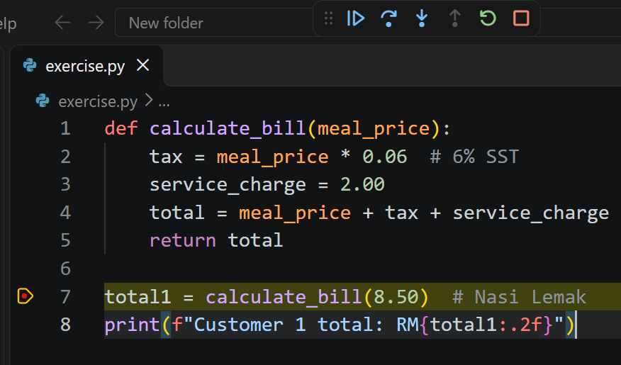
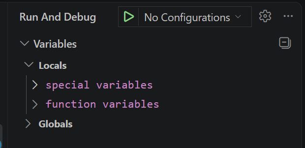
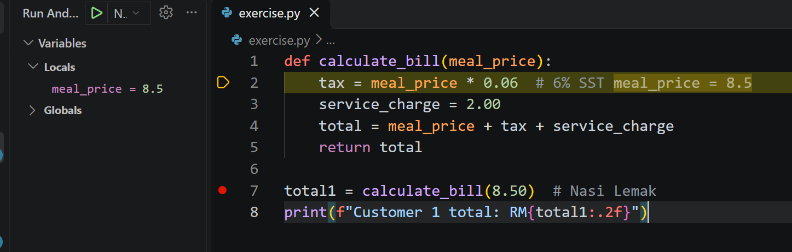
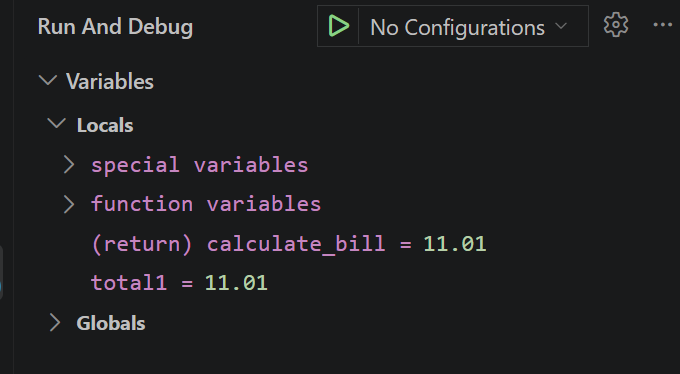

# Lab 01: Functions

A <Term def="A named block of code that does one job. You write it once, then run it as many times as you like by calling its name.">function</Term> lets you write a piece of code once and use it again and again. In this lab you turn repeated code into a function, decide what goes in as parameters, learn the parts of a function, and see why `return` is not the same as `print`. Then you write six functions of your own and check them with **pytest**.

Everything runs in the **VS Code** terminal (Git Bash), inside `CP125-Class-Repo`, as you set it up in the [Pre-Lab](./pre-lab-01.md).

## Get the Latest Changes

<Steps>

1. If your fork on **GitHub** says it is behind, click `Sync fork` → `Update branch`. See [Sync Your Fork](./pre-lab-01.md#syncing-your-fork).

2. Pull the changes to your computer:

   ```console
   $ git pull
   Already up to date.
   ```

   If there were new files, you see a list of them and `Fast-forward` instead.

</Steps>

## Create Your Practice File

<Steps>

1. In the `Explorer`, right-click `labs/lab01`, choose `New File...` and name it `exercise.py`.

2. Check that it runs:

   ```console
   $ uv run python labs/lab01/exercise.py
   ```

   Nothing is printed yet, and there is no error.

</Steps>

::: tip Run it
Every time this lab says **run it**, save the file with `Ctrl` + `S` and run `uv run python labs/lab01/exercise.py` in the terminal.
:::

## Spot the Repetition

A food stall works out every bill the same way: the meal price, plus 6% SST, plus a RM2.00 service charge.

<Do>

Copy this into `exercise.py` and run it:

</Do>

```python
# Customer 1 - Nasi Lemak
price1 = 8.50
tax1 = price1 * 0.06  # 6% SST
service1 = 2.00
total1 = price1 + tax1 + service1
print(f"Customer 1 total: RM{total1:.2f}")

# Customer 2 - Roti Canai
price2 = 3.50
tax2 = price2 * 0.06  # 6% SST
service2 = 2.00
total2 = price2 + tax2 + service2
print(f"Customer 2 total: RM{total2:.2f}")

# Customer 3 - Mee Goreng
price3 = 7.00
tax3 = price3 * 0.06  # 6% SST
service3 = 2.00
total3 = price3 + tax3 + service3
print(f"Customer 3 total: RM{total3:.2f}")
```

```console
$ uv run python labs/lab01/exercise.py
Customer 1 total: RM11.01
Customer 2 total: RM5.71
Customer 3 total: RM9.42
```

The answers are right, but the same four lines appear three times. Only the price is different.

::: warning Problem
If SST goes up to 8%, you must change `0.06` in three places. With 100 customers it is 100 places, and missing one gives a customer the wrong bill.
:::

## Write Your First Function

<Do>

Replace everything in `exercise.py` with this and run it:

</Do>

```python
def calculate_bill(meal_price):
    tax = meal_price * 0.06  # 6% SST
    service_charge = 2.00
    total = meal_price + tax + service_charge
    return total

total1 = calculate_bill(8.50)  # Nasi Lemak
print(f"Customer 1 total: RM{total1:.2f}")

total2 = calculate_bill(3.50)  # Roti Canai
print(f"Customer 2 total: RM{total2:.2f}")

total3 = calculate_bill(7.00)  # Mee Goreng
print(f"Customer 3 total: RM{total3:.2f}")
```

```console
$ uv run python labs/lab01/exercise.py
Customer 1 total: RM11.01
Customer 2 total: RM5.71
Customer 3 total: RM9.42
```

Same output, but the bill is now worked out in **one** place. Compare what it takes to change SST to 8% (the highlighted lines):

<Tabs label="Changing SST to 8%">
<Tab label="Without a function">

Three edits, one per customer:

```python{3,10,17}
# Customer 1 - Nasi Lemak
price1 = 8.50
tax1 = price1 * 0.08
service1 = 2.00
total1 = price1 + tax1 + service1
print(f"Customer 1 total: RM{total1:.2f}")

# Customer 2 - Roti Canai
price2 = 3.50
tax2 = price2 * 0.08
service2 = 2.00
total2 = price2 + tax2 + service2
print(f"Customer 2 total: RM{total2:.2f}")

# Customer 3 - Mee Goreng
price3 = 7.00
tax3 = price3 * 0.08
service3 = 2.00
total3 = price3 + tax3 + service3
print(f"Customer 3 total: RM{total3:.2f}")
```

</Tab>
<Tab label="With a function">

One edit, however many customers there are:

```python{2}
def calculate_bill(meal_price):
    tax = meal_price * 0.08
    service_charge = 2.00
    total = meal_price + tax + service_charge
    return total
```

</Tab>
</Tabs>

### Watch It Run in the Debugger

Reading code tells you what *should* happen. The <Term def="A VS Code tool that pauses your program on a line you choose, then runs it one line at a time while showing the value of every variable.">debugger</Term> shows you what *does* happen, one line at a time. Use it to watch **Python** jump into `calculate_bill`, fill in `meal_price`, and carry `11.01` back out.

Your `exercise.py` should still hold the function from above. These are its line numbers:

```python:line-numbers {7}
def calculate_bill(meal_price):
    tax = meal_price * 0.06  # 6% SST
    service_charge = 2.00
    total = meal_price + tax + service_charge
    return total

total1 = calculate_bill(8.50)  # Nasi Lemak
print(f"Customer 1 total: RM{total1:.2f}")
```

<Steps>

1. Move your mouse just left of line number **7**. A faint red dot appears. Click it to set a <Term def="A marker on a line where the debugger pauses the program before that line runs.">breakpoint</Term>: the dot stays red.

   <p align="center">
       
   </p>

2. Click the **Run and Debug** icon (the play button with a bug) in the left bar, then click `Show automatic Python configurations`.

   <p align="center">
       
   </p>

3. Choose the first `Python Debugger: Python File`, the one marked `cp125-class-repo`.

   <p align="center">
       
   </p>

4. The debugger starts by itself. If it doesn't, click the green play button at the top of **Run and Debug**. Use this button whenever you want to start the debugger again.

   <p align="center">
       
   </p>

5. The program stops at your breakpoint. Line 7 is **yellow**, and a toolbar floats at the top of the editor.

   <p align="center">
       
   </p>

   The yellow line is the line that runs **next**. It has not run yet.

6. Look at `Variables` on the left. `Locals` lists every variable that exists right now.

   <p align="center">
       
   </p>

   Your function is inside the folded `function variables` group. There is no `total1` yet, because line 7 has not run.

7. Click **Step Into**, the blue downward arrow in the toolbar (or press `F11`).

   <p align="center">
       
   </p>

   The yellow line jumps **up** to line 2, inside `calculate_bill`. `Variables` now shows `meal_price = 8.5`, and **VS Code** also writes it at the end of line 2: the argument `8.50` went into the parameter.

   <p align="center">
       
   </p>

8. Click **Step Into** three more times. Each click runs the yellow line and stops on the next one. Watch `Variables`:

   | After click | Yellow line | New in `Variables` |
   |---|---|---|
   | 1 | 3 | `tax = 0.51` |
   | 2 | 4 | `service_charge = 2.0` |
   | 3 | 5 `return total` | `total = 11.01` |

9. Keep clicking **Step Into** until the yellow line is back on line 8, outside the function. Look at `Variables`:

   <p align="center">
       
   </p>

   - `meal_price`, `tax`, `service_charge` and `total` are gone: they only exist while the function runs.
   - `(return) calculate_bill = 11.01` is the value the function sent back.
   - `total1 = 11.01`: line 7 has finished, and the returned value is stored in `total1`.

10. Click the red square in the toolbar to stop the debugger.

</Steps>

#### Your Turn <Badge type="try" text="Try it" />

Add the second customer under line 8, put the breakpoint on it, and step into it again:

```python
total2 = calculate_bill(3.50)  # Roti Canai
```

Check that `Variables` shows `meal_price = 3.5` and `tax = 0.21`, and back outside, `total2 = 5.71`. Same body, different argument.

::: tip Keep using it
The debugger is the fastest way to find out why a function gives the wrong answer. Put a breakpoint on the call, step into the function, and check each variable against what you expected.
:::

::: warning Define it before you call it
Because **Python** reads from top to bottom, the `def` must come before the first call. Move the call above the `def` and you get `NameError: name 'calculate_bill' is not defined`.
:::

## Choose the Parameters

A <Term def="A variable in the function header that receives a value when the function is called, like meal_price.">parameter</Term> is the part of the function that can be different each time you call it. To find the parameters, put the repeated blocks side by side and compare them line by line:

| Line | Customer 1 | Customer 2 | Same every time? |
|---|---|---|---|
| Price | `8.50` | `3.50` | **No** → parameter |
| Tax | `price1 * 0.06` | `price2 * 0.06` | Yes → body |
| Service charge | `2.00` | `2.00` | Yes → body |
| Total | `price1 + tax1 + service1` | `price2 + tax2 + service2` | Yes → body |

Only the price changes, so `calculate_bill` has one parameter, `meal_price`. Everything that stays the same goes inside the function.

### Two Parameters

When more than one value changes, each one becomes a parameter. In these rectangles both the length and the width change:

<Tabs label="Rectangle areas">
<Tab label="Repeated code">

```python
# Rectangle 1
length1 = 5
width1 = 3
area1 = length1 * width1
print(f"Rectangle 1: {area1}")

# Rectangle 2
length2 = 10
width2 = 4
area2 = length2 * width2
print(f"Rectangle 2: {area2}")

# Rectangle 3
length3 = 7
width3 = 2
area3 = length3 * width3
print(f"Rectangle 3: {area3}")
```

</Tab>
<Tab label="With a function">

```python
def calculate_rectangle_area(length, width):
    area = length * width
    return area

print(f"Rectangle 1: {calculate_rectangle_area(5, 3)}")
print(f"Rectangle 2: {calculate_rectangle_area(10, 4)}")
print(f"Rectangle 3: {calculate_rectangle_area(7, 2)}")
```

</Tab>
</Tabs>

<Do>

Type the function version into `exercise.py` and run it:

</Do>

```console
$ uv run python labs/lab01/exercise.py
Rectangle 1: 15
Rectangle 2: 40
Rectangle 3: 14
```

::: tip Finding the parameters
1. Put the repeated blocks side by side.
2. Every value that changes becomes a parameter.
3. Everything that stays the same becomes the body.
:::

#### Your Turn <Badge type="try" text="Try it" />

This code prints two students' marks:

```python
# Student 1
name1 = "Ahmad"
marks1 = 85
print(f"{name1} scored {marks1} marks")

# Student 2
name2 = "Fatimah"
marks2 = 92
print(f"{name2} scored {marks2} marks")
```

<Do>

Write a function `display_score` that replaces the repeated lines, call it once for each student, and run it:

</Do>

```console
$ uv run python labs/lab01/exercise.py
Ahmad scored 85 marks
Fatimah scored 92 marks
```

Decide first: how many parameters does `display_score` need?

## The Parts of a Function

Every function has a **header** and a **body**, and it only runs when you **call** it.

<FunctionParts num="1.1" caption="The parts of calculate_bill and of the line that calls it. The argument and the parameter share a colour: 8.50 goes into meal_price." />

## Parameters and Arguments

A parameter is the empty box in the header. An <Term def="The actual value you pass to a function when you call it, like 8.50 in calculate_bill(8.50).">argument</Term> is the value you put in that box when you call the function. **Python** fills the boxes **in order**: the first argument goes into the first parameter, the second into the second, and so on.

<Figure src="/labs/lab-01/args-to-params.svg" num="1.2" caption="Arguments go into parameters by position: 70 goes into weight, 1.75 goes into height." />

<Do>

Replace the code in `exercise.py` with this and run it:

</Do>

```python
def calculate_bmi(weight, height):
    bmi = weight / (height * height)
    return bmi

result = calculate_bmi(70, 1.75)
print(f"BMI: {result:.2f}")
```

```console
$ uv run python labs/lab01/exercise.py
BMI: 22.86
```

### Order and Number Matter

The arguments must match the parameters in **number** and in **order**. See what happens to this function when they don't:

```python
def calculate_total(price, quantity, discount):
    subtotal = price * quantity
    total = subtotal - discount
    return total
```

<Tabs label="Calling calculate_total">
<Tab label="Correct">

```python
print(calculate_total(50, 3, 10))  # price=50, quantity=3, discount=10
```

```console
$ uv run python labs/lab01/exercise.py
140
```

Three arguments in the right order: 50 × 3 − 10 = 140.

</Tab>
<Tab label="Wrong order">

```python
print(calculate_total(10, 3, 50))  # price=10, quantity=3, discount=50
```

```console
$ uv run python labs/lab01/exercise.py
-20
```

No error, but the answer is wrong: **Python** put `10` into `price` and `50` into `discount`. This is the dangerous one, because nothing warns you.

</Tab>
<Tab label="Missing argument">

```python
print(calculate_total(50, 3))
```

```console
$ uv run python labs/lab01/exercise.py
Traceback (most recent call last):
  ...
TypeError: calculate_total() missing 1 required positional argument: 'discount'
```

Two arguments for three parameters, so **Python** stops with a `TypeError`.

</Tab>
</Tabs>

## Return vs Print

`print` and `return` both seem to "give you the answer", but they do different jobs:

| | `print(value)` | `return value` |
|---|---|---|
| Shows the value on the screen | Yes | No |
| Gives the value back to the caller | No | Yes |
| Can you store or calculate with it? | No | Yes |

<Steps>

1. Replace the code in `exercise.py` with this and run it:

   ```python
   def add_with_print(a, b):
       result = a + b
       print(result)  # shows the number

   def add_with_return(a, b):
       result = a + b
       return result  # gives the number back

   x = add_with_print(5, 3)
   print(f"x contains: {x}")

   y = add_with_return(5, 3)
   print(f"y contains: {y}")
   ```

   ```console
   $ uv run python labs/lab01/exercise.py
   8
   x contains: None
   y contains: 8
   ```

   `add_with_print` showed `8` on the screen but gave nothing back, so `x` is <Term def="Python's value for 'nothing'. A function without a return statement gives back None.">None</Term>. A function with no `return` always gives back `None`.

2. Now try to use `x` and `y` in a calculation. Add these two lines at the bottom and run it again:

   ```python
   print(y + 1)
   print(x + 1)
   ```

   ```console
   $ uv run python labs/lab01/exercise.py
   8
   x contains: None
   y contains: 8
   9
   Traceback (most recent call last):
     ...
   TypeError: unsupported operand type(s) for +: 'NoneType' and 'int'
   ```

   `y + 1` works because `y` holds `8`. `x + 1` fails because `x` holds `None`, and you can't add 1 to nothing.

</Steps>

::: tip When to use each
Use `return` when the result is needed by the rest of your program: to store it, compare it or calculate with it. Use `print` only to show something to the user.
:::

## Test Your Exercises

Each exercise file starts empty: write the whole function yourself, `def` line included, with the exact name and parameters the exercise gives. Run the **pytest** tests for each exercise before you move on to the next one.

## Exercise 1: Road Trip Budgeter <Badge type="warning" text="Task" />

<Do>

Open `labs/lab01/exercise1/exercise1.py`.

</Do>

**Situation:**

A driver wants to know if their money is enough for a **round trip**: to the destination and back again.

**Task:**

Write a function `is_budget_sufficient` that returns `True` if the fuel for the whole round trip costs **no more than** the budget, and `False` otherwise.

| Parameter | Meaning |
|---|---|
| `one_way_km` | Distance to the destination, in km |
| `km_per_liter` | How many km the car travels on 1 litre of fuel |
| `price_per_liter` | Price of 1 litre of fuel, in RM |
| `budget` | Money the driver has, in RM |

**Example:**

| Call | Returns | Why |
|---|---|---|
| `is_budget_sufficient(100, 10, 2.00, 40)` | `True` | 200 km needs 20 litres, which costs RM40.00 |
| `is_budget_sufficient(100, 10, 2.00, 39)` | `False` | RM40.00 is more than RM39 |

## Exercise 2: Camping Logistics <Badge type="warning" text="Task" />

<Do>

Open `labs/lab01/exercise2/exercise2.py`.

</Do>

**Situation:**

A camp organiser needs the total cost of an event: the tents plus the food. Every tent holds the same number of people, and you can't rent part of a tent: 13 people with 4 per tent need **4** tents, not 3.25.

**Task:**

Write a function `calculate_event_cost` that returns the total cost of the tents and the food.

| Parameter | Meaning |
|---|---|
| `participants` | Number of people at the camp |
| `tent_capacity` | Number of people one tent holds |
| `tent_price` | Price of one tent, in RM |
| `meal_price` | Food cost for one person, in RM |

**Example:**

| Call | Returns | Why |
|---|---|---|
| `calculate_event_cost(12, 4, 100, 10)` | `420` | 3 tents (RM300) + food for 12 (RM120) |
| `calculate_event_cost(13, 4, 100, 10)` | `530` | 4 tents (RM400) + food for 13 (RM130) |

::: tip Rounding up
`math.ceil` rounds a number **up**: `math.ceil(3.25)` is `4`. Add `import math` at the top of your file to use it.
:::

## Exercise 3: Secure Vault System <Badge type="warning" text="Task" />

<Do>

Open `labs/lab01/exercise3/exercise3.py`.

</Do>

**Situation:**

A vault only opens for two people, each with their own PIN:

| Name | PIN |
|---|---|
| `"Director"` | `1122` |
| `"Security"` | `9900` |

Any other name, any other PIN, or a correct PIN with the wrong name must be refused.

**Task:**

Write a function `validate_entry(name, pin)` that returns `True` if the entry is allowed and `False` otherwise. `name` is a string and must match exactly, capital letters included. `pin` is a whole number.

**Example:**

| Call | Returns | Why |
|---|---|---|
| `validate_entry("Director", 1122)` | `True` | Right name, right PIN |
| `validate_entry("Director", 9900)` | `False` | That is the Security PIN |
| `validate_entry("director", 1122)` | `False` | Small d: the name must match exactly |

## Exercise 4: Dynamic Parking Rate <Badge type="warning" text="Task" />

<Do>

Open `labs/lab01/exercise4/exercise4.py`.

</Do>

**Situation:**

A car park charges by the hour, and the rate depends on the vehicle and the time:

| Vehicle | Hourly rate |
|---|---|
| `"Electric"` | RM2.00 at any time |
| `"Hybrid"` | RM2.00 from 10pm to 6am (hours `22` to `6`, both included), RM5.00 at other times |
| Any other vehicle | RM5.00 at any time |

**Task:**

Write a function `get_hourly_rate(vehicle_type, hour_24)` that returns the hourly rate as a number. `hour_24` is the hour of the day, from `0` to `23`.

**Example:**

| Call | Returns |
|---|---|
| `get_hourly_rate("Hybrid", 23)` | `2.0` |
| `get_hourly_rate("Hybrid", 13)` | `5.0` |
| `get_hourly_rate("Sedan", 2)` | `5.0` |

## Exercise 5: Triangle Checker <Badge type="warning" text="Task" />

<Do>

Open `labs/lab01/exercise5/exercise5.py`.

</Do>

**Situation:**

A geometry app needs to know if three lengths can form a triangle. They can only if **every** pair of sides adds up to more than the third side:

1. `a + b > c`
2. `a + c > b`
3. `b + c > a`

**Task:**

Write a function `is_valid_triangle(a, b, c)` that returns `True` if the three lengths can form a triangle, and `False` otherwise.

**Example:**

| Call | Returns | Why |
|---|---|---|
| `is_valid_triangle(3, 4, 5)` | `True` | Every pair adds up to more than the third side |
| `is_valid_triangle(1, 2, 3)` | `False` | 1 + 2 is not more than 3 |

## Exercise 6: Leap Year Detector <Badge type="warning" text="Task" />

<Do>

Open `labs/lab01/exercise6/exercise6.py`.

</Do>

**Situation:**

A calendar app has to know which years have a 29 February. A year is a leap year if:

1. it divides exactly by 4,
2. **but not** if it also divides exactly by 100,
3. **unless** it also divides exactly by 400.

| Year | Leap year? | Why |
|---|---|---|
| 2024 | Yes | Divides by 4 |
| 1900 | No | Divides by 100 |
| 2000 | Yes | Divides by 400 |

**Task:**

Write a function `is_leap_year(year)` that returns `True` for a leap year and `False` otherwise.

**Example:**

| Call | Returns |
|---|---|
| `is_leap_year(2024)` | `True` |
| `is_leap_year(1900)` | `False` |

## Commit and Push Your Work

<Steps>

1. Run all the Lab 1 tests one last time.

2. Commit your work and push it to **GitHub**:

   ```console
   $ git add labs/lab01
   $ git commit -m "Complete Lab 1: Functions"
   $ git push
   ...
      a1b2c3d..e4f5a6b  main -> main
   ```

3. Refresh `github.com/GITHUB-USERNAME/CP125-Class-Repo` in the browser.

   You see the commit message **Complete Lab 1: Functions** on `labs/lab01`.

</Steps>

<!-- Rest of Lab 1, hidden while the first half is reworked.

## Factorization: Don't Repeat Yourself

Factorization is the process of taking repeated code and extracting it into a reusable function. This is one of the most important principles in programming.

### Identifying Repetition

Look for these signs that indicate you need factorization:
1. You're copy-pasting code blocks
2. The same calculation appears multiple times
3. Only the values change, but the logic stays the same

<Do>

Copy this into `exercise.py` and run it:

</Do>

```python
# Calculating areas without factorization
pi = 3.14159

# Circle 1
radius1 = 5
area1 = pi * radius1 * radius1
print(f"Circle 1 (radius {radius1}): Area = {area1:.2f}")

# Circle 2
radius2 = 10
area2 = pi * radius2 * radius2
print(f"Circle 2 (radius {radius2}): Area = {area2:.2f}")

# Circle 3
radius3 = 7
area3 = pi * radius3 * radius3
print(f"Circle 3 (radius {radius3}): Area = {area3:.2f}")
```

```console
$ uv run python labs/lab01/exercise.py
Circle 1 (radius 5): Area = 78.54
Circle 2 (radius 10): Area = 314.16
Circle 3 (radius 7): Area = 153.94
```

Notice how `pi * radius * radius` appears three times? This is a perfect candidate for factorization.

### Refactoring with Functions

Refactoring means improving code structure without changing what it does.

<Do>

Replace the code above with this factorized version and run it:

</Do>

```python
def calculate_circle_area(radius):
    pi = 3.14159
    area = pi * radius * radius
    return area

# Now the calculation is defined once and reused
area1 = calculate_circle_area(5)
print(f"Circle 1 (radius 5): Area = {area1:.2f}")

area2 = calculate_circle_area(10)
print(f"Circle 2 (radius 10): Area = {area2:.2f}")

area3 = calculate_circle_area(7)
print(f"Circle 3 (radius 7): Area = {area3:.2f}")
```

The output is the same. The benefits are immediate:
- If you need to calculate 100 circles, you just call the function 100 times
- If you need a more precise value of pi (3.14159265), you change only one line
- The code is shorter and easier to read

## Single Responsibility Principle

Each function should have **one** clear job. When a function tries to do too many things, it becomes difficult to understand, test, and modify.

### Recognizing Multiple Responsibilities

A function has multiple responsibilities if it:
- Gets input AND processes it AND displays output
- Performs multiple unrelated calculations
- Makes decisions AND displays results

<Do>

Copy this into `exercise.py`, run it, and type a name and a score when asked:

</Do>

```python
def process_student():
    # Responsibility 1: Getting input
    name = input("Enter student name: ")
    score = int(input("Enter score: "))

    # Responsibility 2: Making decision
    if score >= 50:
        status = "Pass"
    else:
        status = "Fail"

    # Responsibility 3: Displaying output
    print(f"Student: {name}")
    print(f"Score: {score}")
    print(f"Status: {status}")

# Run the function
process_student()
```

```console
$ uv run python labs/lab01/exercise.py
Enter student name: Ali
Enter score: 72
Student: Ali
Score: 72
Status: Pass
```

This function does three completely different jobs. What if you want to change how pass/fail is determined but keep the same input method? You'd have to dig through all the code.

### Splitting Responsibilities

A better approach is to split this into three focused functions:

```python
def get_student_data():
    name = input("Enter student name: ")
    score = int(input("Enter score: "))
    return name, score

def determine_status(score):
    if score >= 50:
        return "Pass"
    else:
        return "Fail"

def display_results(name, score, status):
    print(f"Student: {name}")
    print(f"Score: {score}")
    print(f"Status: {status}")

# Use them together
student_name, student_score = get_student_data()
student_status = determine_status(student_score)
display_results(student_name, student_score, student_status)
```

Now each function has one clear purpose:

| Function | Its one job |
|---|---|
| `get_student_data()` | Handles input |
| `determine_status()` | Makes the pass/fail decision |
| `display_results()` | Shows information |

If the passing grade changes to 60, you only modify `determine_status()`. The other functions remain untouched.

::: tip The 5-word test
If you can't describe what a function does in 5 words or less, it probably does too much and should be split.
:::

## Decomposition: Breaking Down Complex Problems

Decomposition is the art of breaking a large, complex task into smaller, manageable functions. Instead of writing one massive function that does everything, you create several small functions that each handle one piece of the puzzle.

### Why Decompose?

Consider calculating an employee's monthly salary:
1. Base salary
2. Add allowances (transport, meal)
3. Add overtime pay
4. Subtract EPF (11%)
5. Subtract SOCSO (2%)
6. Calculate net salary

Writing this as one long calculation is error-prone and hard to understand. Instead, decompose it into steps.

### Step-by-Step Decomposition

<Do>

Create separate functions for each calculation step. Copy this into `exercise.py` and run it:

</Do>

```python
def calculate_allowances():
    transport = 200.00
    meal = 150.00
    return transport + meal

def calculate_overtime(base_salary, overtime_hours):
    hourly_rate = base_salary / 160  # Assuming 160 working hours per month
    overtime_rate = hourly_rate * 1.5  # 1.5x for overtime
    return overtime_hours * overtime_rate

def calculate_epf(gross_salary):
    return gross_salary * 0.11

def calculate_socso(gross_salary):
    return gross_salary * 0.02

def calculate_net_salary(base_salary, overtime_hours):
    # Step 1: Calculate gross salary
    allowances = calculate_allowances()
    overtime = calculate_overtime(base_salary, overtime_hours)
    gross = base_salary + allowances + overtime

    # Step 2: Calculate deductions
    epf = calculate_epf(gross)
    socso = calculate_socso(gross)

    # Step 3: Calculate net
    net = gross - epf - socso
    return net

# Use it
salary = calculate_net_salary(5000, 10)
print(f"Net salary: RM{salary:.2f}")
```

```console
$ uv run python labs/lab01/exercise.py
Net salary: RM5062.31
```

Each function is simple and focused. If EPF rate changes, you only modify `calculate_epf()`. If overtime rules change, you only modify `calculate_overtime()`.

This approach makes debugging easier too. If the final number seems wrong, you can test each function individually to find which step has the bug.

## Exercise 7: Rectangle Collision <Badge type="warning" text="Task" />

<Do>

Open `labs/lab01/exercise7/exercise7.py`.

</Do>

**Situation:**

A game engine needs to detect if two objects (rectangles) have crashed into each other.

**Task:**

Write a function `check_collision(x1, y1, w1, h1, x2, y2, w2, h2)` that returns `True` if the rectangles overlap, `False` if they don't.

| Parameter | Meaning |
|---|---|
| `x1, y1` | Top-left coordinate of Rectangle 1 |
| `w1, h1` | Width and height of Rectangle 1 |
| `x2, y2` | Top-left coordinate of Rectangle 2 |
| `w2, h2` | Width and height of Rectangle 2 |

::: tip Hint
It is easier to check when they **DON'T** overlap:
- Rect 1 is too far to the Left of Rect 2
- Rect 1 is too far to the Right of Rect 2
- Rect 1 is too high above Rect 2
- Rect 1 is too low below Rect 2

If NONE of these are true, they must be touching!
:::

## Exercise 8: Bouncing Ball Simulation <Badge type="warning" text="Task" />

<Do>

Open `labs/lab01/exercise8/exercise8.py`.

</Do>

**Situation:**

A ball is dropped from a certain height. When it hits the ground, it bounces back up but only reaches 80% of its previous height due to energy loss. The ball continues bouncing, getting lower each time, until the bounce height becomes less than 1 unit. At that point, the ball is considered stopped.

Your task is to simulate this bouncing behavior.

**You need to calculate:**
1. How many times the ball bounces before stopping
2. The total distance traveled by the ball (including the initial drop and all bounces up and down)

**Rules:**
- Each bounce reaches 80% of the previous height
- Ball stops when bounce height is less than 1
- Total distance includes: initial drop + (each bounce up + down)

**Task:**

Write functions that work together to simulate the bouncing ball and return the bounce count and total distance.

## Exercise 9: Level Up Calculator <Badge type="warning" text="Task" />

<Do>

Open `labs/lab01/exercise9/exercise9.py`.

</Do>

**Situation:**

In a game, leveling up requires XP. Each level requires more XP than the previous:

| Level up | XP needed |
|---|---|
| 1 → 2 | 100 |
| 2 → 3 | 200 |
| 3 → 4 | 300 |
| ... | +100 more each level |

A player has a total amount of XP. Calculate what level they reach and how much XP is left over.

**You need to find:**
1. The player's final level
2. The remaining XP after leveling

**Rules:**
- Start at level 1
- Each level costs 100 more XP than the previous
- Keep leveling up until not enough XP for next level

**Task:**

Write functions that work together to calculate the player's final level and remaining XP.

## Exercise 10: Drone Battery Manager <Badge type="warning" text="Task" />

<Do>

Open `labs/lab01/exercise10/exercise10.py`.

</Do>

**Situation:**

A drone is performing a forest survey. It consumes **1.5% battery per 10 meters** traveled. If the drone is in **"Sport Mode"**, this battery consumption **increases by 50%**. The drone needs to know if it has enough power to complete its mission and safely fly back to its starting point.

**Task:**

Write functions that work together to estimate battery usage for a **round trip** and return if it is safe to fly.

## Exercise 11: ATM Request Processor <Badge type="warning" text="Task" />

<Do>

Open `labs/lab01/exercise11/exercise11.py`.

</Do>

**Situation:**

A bank ATM processes withdrawal requests. For security and mechanical reasons:
1. All withdrawals must be in **multiples of RM10**.
2. The customer must have a **sufficient account balance**.

**Task:**

Write functions that work together to validate these rules and return the new balance if successful, or an error message.

## Exercise 12: RPG Strike Calculator <Badge type="warning" text="Task" />

<Do>

Open `labs/lab01/exercise12/exercise12.py`.

</Do>

**Situation:**

A role-playing game calculates combat damage based on a hero's **Luck** and **Base Attack**. If the hero's Luck is **above 70**, they land a "Critical Hit" that **doubles** their attack power. The final damage dealt is the attack power minus the **Enemy's Defense**.

**Task:**

Write functions that work together to calculate the enemy's final health (Health - Damage) and return it.

## Exercise 13: Global Shipping Quoter <Badge type="warning" text="Task" />

<Do>

Open `labs/lab01/exercise13/exercise13.py`.

</Do>

**Situation:**

A shipping firm calculates delivery costs based on weight and destination:

| Charge | Rate |
|---|---|
| Domestic | RM5.00 per kg |
| International | RM15.00 per kg |
| Express Surcharge | Flat RM10.00 if the user selects "Express Delivery" |

**Task:**

Write functions that work together to calculate and return the final shipping quote.

## Exercise 14: Smart Garden Controller <Badge type="warning" text="Task" />

<Do>

Open `labs/lab01/exercise14/exercise14.py`.

</Do>

**Situation:**

A smart home system manages garden watering. It should turn on the pump ONLY if:
1. Soil moisture is **below 30%**.
2. It is a **safe time** to water. (It is dangerous to water between **10 AM and 4 PM** because the sun might scorch the leaves, UNLESS the temperature is **above 40°C**, in which case the plants need cooling anyway).

**Task:**

Write functions that work together to decide if the water pump should be triggered.

-->
