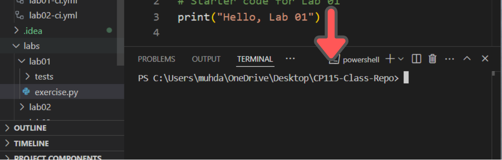
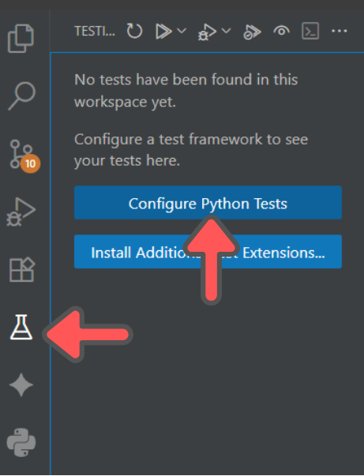

# Pre-Lab: Set Up Your Development Environment and Revision

In this pre-lab you set up **Git Bash**, **GitHub** and **Python**, and get your own copy of `CP125-Class-Repo` onto your computer. Everything is done in **Git Bash**.

You need a **GitHub** account, and **Python**, **Git** and **VS Code** installed. If they aren't, follow the [**Git**](/labs/installation#git) and [**VS Code**](/labs/installation#vs-code) installation guides first.

<YourDetails />

## Fork the Class Repository

<Do>

Open the [`CP125-Class-Repo`](https://github.com/JSK-KML/CP125-Class-Repo) on **GitHub**, click `Fork`, then `Create fork`.

</Do>

<p align="center">
    
</p>

The page now shows GITHUB-USERNAME/CP125-Class-Repo, forked from JSK-KML/CP125-Class-Repo.

## Open Git Bash

<Do>

Press the `Windows` key, type `Git Bash` and open it.

</Do>

A terminal window opens with a prompt ending in `$`.

## Log In to GitHub

<Steps>

1. Run in Git Bash:

   ```console
   $ gh auth login
   ```

2. Choose these answers with the arrow keys and `Enter`:

   | Question | Answer |
   |---|---|
   | Where do you use GitHub? | `GitHub.com` |
   | Preferred protocol for Git operations? | `HTTPS` |
   | Authenticate Git with your GitHub credentials? | `Yes` |
   | How would you like to authenticate? | `Login with a web browser` |

3. Copy the one-time code, press `Enter`, paste the code in the browser and click `Authorize`.

   The terminal shows `✓ Logged in as GITHUB-USERNAME`.

</Steps>

::: warning On a shared lab computer
Run `gh auth logout` before you leave, so the next student can't push to your fork.
:::

## Create Your Course Folder

<Do>Run these in Git Bash:</Do>

```console
$ cd ~
$ mkdir YOURNAME-CP125
$ cd YOURNAME-CP125
$ pwd
/c/Users/you/YOURNAME-CP125
```

| Command | What it does |
|---|---|
| `cd ~` | Go to your home folder |
| `mkdir NAME` | Make a new folder called `NAME` |
| `cd NAME` | Go into the folder `NAME` |
| `pwd` | Print the folder you are in now |

## Clone Your Fork

<Steps>

1. Inside `YOURNAME-CP125`, run:

   ```console
   $ git clone https://github.com/GITHUB-USERNAME/CP125-Class-Repo.git
   Cloning into 'CP125-Class-Repo'...
   $ cd CP125-Class-Repo
   $ ls
   README.md  labs/
   ```

2. Remove the name and email left on this computer by anyone before you:

   ```console
   $ git config --global --unset user.name
   $ git config --global --unset user.email
   ```

3. Set your own name and email, for this repository only:

   ```console
   $ git config user.name "GITHUB-USERNAME"
   $ git config user.email "GITHUB-EMAIL"
   $ git config user.email
   GITHUB-EMAIL
   ```

4. Open the repository in **VS Code**:

   ```console
   $ code .
   ```

   **VS Code** opens with `CP125-CLASS-REPO` in the `Explorer`. You can close the Git Bash window now.

</Steps>

## Set Up VS Code

<Steps>

1. Open `Extensions`, search for `Python` and install the one by **Microsoft**.

   <p align="center">
       
   </p>

2. Press `Ctrl` + `Shift` + `P`, type `Terminal: Select Default Profile` and choose `Git Bash`.

3. Click `Terminal` → `New Terminal`.

   <p align="center">
       
   </p>

   A Git Bash terminal opens at the bottom of **VS Code**, already inside `CP125-Class-Repo`. Use this terminal for the rest of the pre-lab.

   <p align="center">
       
   </p>

</Steps>

## Set Up Python with uv

<Steps>

1. In the **VS Code** terminal, install **uv**:

   ```console
   $ curl -LsSf https://astral.sh/uv/install.sh | sh
   ...
   everything's installed!
   ```

2. Close the terminal with the bin icon, open a new one (`Terminal` → `New Terminal`), and check:

   ```console
   $ uv --version
   uv 0.13.8
   ```

3. Create the environment from the list in `CP125-Class-Repo`:

   ```console
   $ uv sync
   Using CPython 3.14.0 interpreter at: C:\Python314\python.exe
   Creating virtual environment at: .venv
   Resolved 7 packages in 2ms
   Installed 6 packages in 492ms
    + pytest==9.2.0
   ...
   ```

   A `.venv` folder appears in the `Explorer`, with **Python** and every package the course needs, including **pytest**.

4. Run a file through it:

   ```console
   $ uv run python labs/pre-lab/hello.py
   Hello, CP125
   ```

</Steps>

::: tip Run everything with uv run
Use `uv run python FILE` and `uv run pytest`, so your code always uses the packages in `.venv`.
:::

## Commit, Push and Pull

<Steps>

1. In the `Explorer`, open `labs/pre-lab/hello.py`, add this line under the one that is there, and save with `Ctrl` + `S`:

   ```python
   print("My name is YOURNAME")
   ```

2. Check what **Git** sees:

   ```console
   $ git status
   Changes not staged for commit:
           modified:   labs/pre-lab/hello.py
   ```

3. Commit it and push it to **GitHub**:

   ```console
   $ git add labs/pre-lab/hello.py
   $ git commit -m "Add my name to hello.py"
   $ git push
   ...
      a1b2c3d..e4f5a6b  main -> main
   ```

4. Refresh `github.com/GITHUB-USERNAME/CP125-Class-Repo` in the browser.

   You see the commit message **Add my name to hello.py** on `labs/pre-lab`.

5. Pull from **GitHub**:

   ```console
   $ git pull
   Already up to date.
   ```

</Steps>

| Command | What it does |
|---|---|
| `git status` | Show which files have changed |
| `git add FILE` | Choose a change for the next commit (`git add .` = everything) |
| `git commit -m "..."` | Save a snapshot with a message |
| `git push` | Send your commits to **GitHub** |
| `git pull` | Get new commits from **GitHub** |

## Sync Your Fork {#syncing-your-fork}

<Steps>

1. When your fork on **GitHub** says it is behind, click `Sync fork` → `Update branch`.

2. Pull the changes to your computer:

   ```console
   $ git pull
   Already up to date.
   ```

</Steps>

## Set Up Testing in VS Code

<Steps>

1. Press `Ctrl` + `Shift` + `P`, type `Python: Select Interpreter` and choose the one in `.venv`.

2. In `Extensions`, install **Python Test Explorer** by **Little Fox Team**.

   <p align="center">
       
   </p>

3. Click the flask icon → `Configure Python Tests` → `pytest` → `Root Directory`.

   <div class="img-row">
       
       
       
   </div>

</Steps>

::: info Don't see Configure Python Tests?
It only appears once the repository has tests in it. Skip this step for now if it isn't there.
:::

## Working on Another PC

<Steps>

1. On a new PC (your laptop, or a different lab PC), install **Git** and **VS Code**, then do [Log In to GitHub](#log-in-to-github), [Create Your Course Folder](#create-your-course-folder), [Clone Your Fork](#clone-your-fork) and the first two steps of [Set Up Python with uv](#set-up-python-with-uv).

2. Inside `CP125-Class-Repo`, run:

   ```console
   $ uv sync
   ```

   You now have the same environment as on the lab PC.

3. When a lab needs a new package, [sync your fork](#syncing-your-fork), then run:

   ```console
   $ git pull
   $ uv sync
   ```

</Steps>

## Finish Up

::: warning On a shared lab computer
Run `gh auth logout` before you leave.
:::
