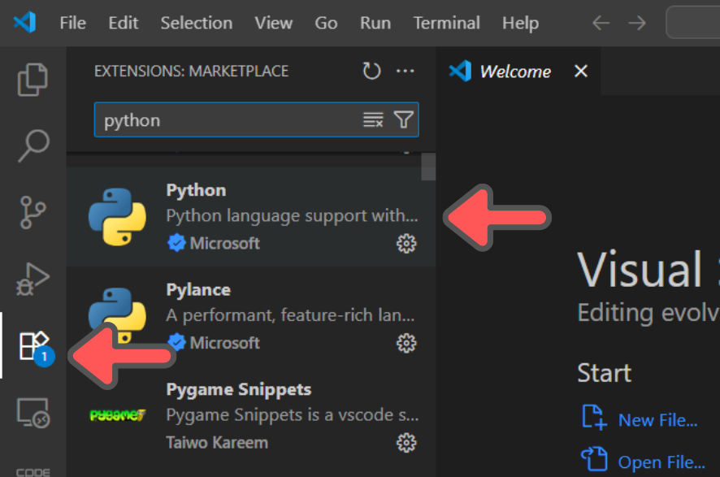
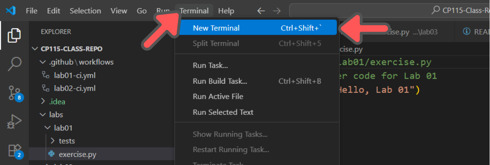
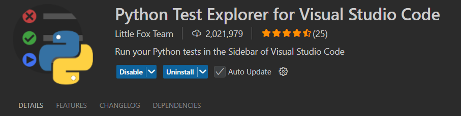

# Pre-Lab: Set Up Your Development Environment and Revision

In this pre-lab you set up **Git Bash**, **GitHub** and **Python**, and get your own copy of `CP125-Class-Repo` onto your computer. Everything is done in **Git Bash**.

You need a **GitHub** account, and **Python**, **Git** and **VS Code** installed. If they aren't, follow the [**Git**](/labs/installation#git) and [**VS Code**](/labs/installation#vs-code) installation guides first.

<YourDetails />

## Install the Python Extension

<Do>

In **VS Code**, open `Extensions`, search for `Python` and install the one by **Microsoft**.

</Do>

<p align="center">
    
</p>

## Open Git Bash in VS Code

<Steps>

1. Press `Ctrl` + `Shift` + `P`, type `Terminal: Select Default Profile` and choose `Git Bash`.

2. Click `Terminal` → `New Terminal`.

   <p align="center">
       
   </p>

   A terminal opens at the bottom of **VS Code**, with a prompt ending in `$`.

   <p align="center">
       
   </p>

</Steps>

## Fork the Class Repository

<Do>

Open the [`CP125-Class-Repo`](https://github.com/JSK-KML/CP125-Class-Repo) on **GitHub**, click `Fork`, then `Create fork`.

</Do>

<p align="center">
    
</p>

The page now shows GITHUB-USERNAME/CP125-Class-Repo, forked from JSK-KML/CP125-Class-Repo.

## Log In to GitHub

<Steps>

1. Run in Git Bash:

   ```console
   $ gh auth login
   ```

2. Choose these answers with the arrow keys and `Enter`:

   | Question | Answer |
   |---|---|
   | Where do you use GitHub? | `GitHub.com` |
   | Preferred protocol for Git operations? | `HTTPS` |
   | Authenticate Git with your GitHub credentials? | `Yes` |
   | How would you like to authenticate? | `Login with a web browser` |

3. Copy the one-time code, press `Enter`, paste the code in the browser and click `Authorize`.

   The terminal shows `✓ Logged in as GITHUB-USERNAME`.

4. Set the name and email for your commits:

   ```console
   $ git config --global user.name "GITHUB-USERNAME"
   $ git config --global user.email "GITHUB-EMAIL"
   ```

</Steps>

::: warning On a shared lab computer
Run `gh auth logout` before you leave, so the next student can't push to your fork.
:::

## Create Your Course Folder

<Do>Run these in Git Bash:</Do>

```console
$ cd ~
$ mkdir YOURNAME-CP125
$ cd YOURNAME-CP125
$ pwd
/c/Users/you/YOURNAME-CP125
```

| Command | What it does |
|---|---|
| `cd ~` | Go to your home folder |
| `mkdir NAME` | Make a new folder called `NAME` |
| `cd NAME` | Go into the folder `NAME` |
| `pwd` | Print the folder you are in now |

## Clone Your Fork

<Steps>

1. Inside `YOURNAME-CP125`, run:

   ```console
   $ git clone https://github.com/GITHUB-USERNAME/CP125-Class-Repo.git
   Cloning into 'CP125-Class-Repo'...
   $ cd CP125-Class-Repo
   $ ls
   README.md  labs/
   ```

2. Open the repository in **VS Code**:

   ```console
   $ code .
   ```

   **VS Code** opens with `CP125-CLASS-REPO` in the `Explorer`. Open a new terminal there (`Terminal` → `New Terminal`); it starts inside `CP125-Class-Repo`.

</Steps>

## Make Your First Commit and Push

<Steps>

1. Create a small file and run it:

   ```console
   $ echo 'print("Hello, CP125")' > labs/lab01/hello.py
   $ python labs/lab01/hello.py
   Hello, CP125
   ```

2. Check what **Git** sees:

   ```console
   $ git status
   Untracked files:
           labs/lab01/hello.py
   ```

3. Commit it and push it to **GitHub**:

   ```console
   $ git add labs/lab01/hello.py
   $ git commit -m "Add hello.py"
   $ git push
   ...
      a1b2c3d..e4f5a6b  main -> main
   ```

4. Refresh `github.com/GITHUB-USERNAME/CP125-Class-Repo` in the browser.

   You see the commit message **Add hello.py**, and `hello.py` inside `labs/lab01`.

</Steps>

| Command | What it does |
|---|---|
| `git status` | Show which files have changed |
| `git add FILE` | Choose a change for the next commit (`git add .` = everything) |
| `git commit -m "..."` | Save a snapshot with a message |
| `git push` | Send your commits to **GitHub** |

## Sync Your Fork {#syncing-your-fork}

<Steps>

1. When your fork on **GitHub** says it is behind, click `Sync fork` → `Update branch`.

2. Pull the changes to your computer:

   ```console
   $ git pull
   Already up to date.
   ```

</Steps>

## Create a Virtual Environment

<Do>Inside CP125-Class-Repo, create and activate it:</Do>

```console
$ python -m venv cp125_env
$ source cp125_env/Scripts/activate
$ python --version
Python 3.13.1
```

Your prompt now starts with `(cp125_env)`, and a `cp125_env` folder appears in the `Explorer`.

::: tip Every new terminal
Run `source cp125_env/Scripts/activate` each time you open a new terminal.
:::

## Run a Small Program

<Steps>

1. Create `labs/lab01/test_virtual_env.py` with this code, using your own name and ID:

   ```python
   student_name = "Your Name"
   student_id = "Your ID"
   course_code = "CP125"

   print(student_name)
   print(student_id)
   print(course_code)
   ```

2. Run it:

   ```console
   $ python labs/lab01/test_virtual_env.py
   Your Name
   Your ID
   CP125
   ```

</Steps>

## Install pytest

<Do>With (cp125_env) showing in the prompt, run:</Do>

```console
$ python -m pip install pytest
...
Successfully installed iniconfig-2.0.0 packaging-25.0 pluggy-1.6.0 pytest-8.4.1
```

## Set Up Testing in VS Code

<Steps>

1. In `Extensions`, install **Python Test Explorer** by **Little Fox Team**.

   <p align="center">
       
   </p>

2. Click the flask icon → `Configure Python Tests` → `pytest` → `Root Directory`.

   <p align="center">
       
       
       
   </p>

</Steps>

::: info Don't see Configure Python Tests?
It only appears once the repository has tests in it. Skip this step for now if it isn't there.
:::

## Finish Up

<Do>Switch the virtual environment off:</Do>

```console
$ deactivate
```

::: warning On a shared lab computer
Run `gh auth logout` before you leave.
:::
