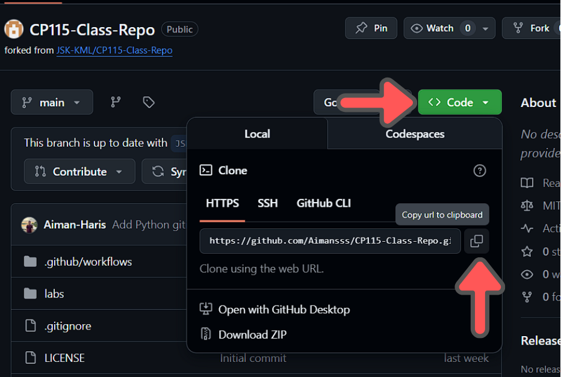
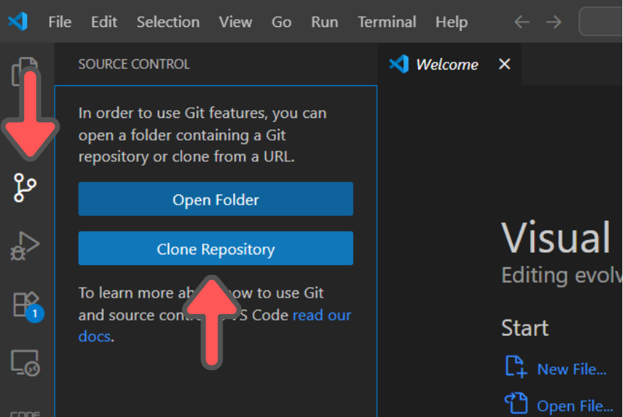
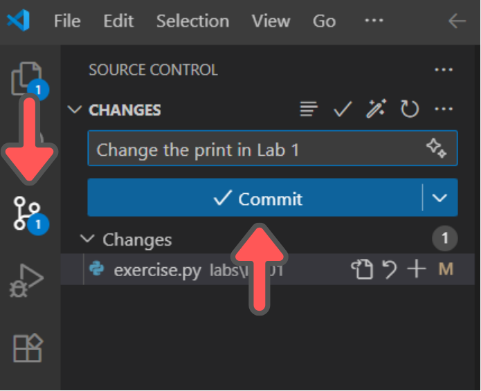
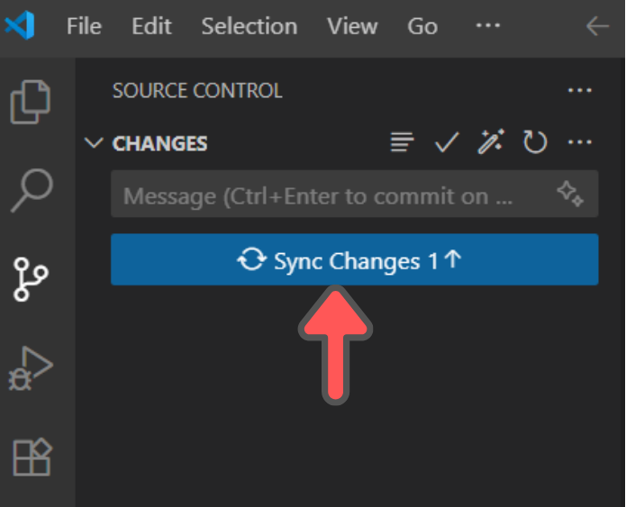
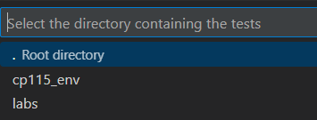

# Pre-Lab: Set Up Your Development Environment and Revision

This pre-lab walks you through setting up **Git** and **VS Code**, then using either the **VS Code** buttons or **Git** commands to manage the `CP125-Class-Repo` on **GitHub**.

<Checklist title="Before you start" color="blue">

- A **GitHub** account that you can log in to
- **Python** installed (search `python` in the Microsoft Store if you don't have it)
- **Git** and **VS Code** installed (see below)

</Checklist>

## Install Git and VS Code

- Follow the [**Git** installation guide](/labs/installation#git) for details on downloading and configuring **Git**.
- Follow the [**VS Code** installation guide](/labs/installation#vs-code) to install the editor.
- In **VS Code**, open the `Extensions` panel and install the **Python** extension from **Microsoft**.

<br>

<p align="center">
    
</p>

## Choosing Your Terminal

You'll type commands in the terminal throughout this pre-lab. On Windows, **VS Code** opens **PowerShell** by default, but you can also use **Git Bash**. Where the commands differ, the page shows a tab for each, so pick one and follow its tab in every step below.

::: tip Which one should I use?
On the **lab computers**, use **Git Bash**. PowerShell on those machines is restricted and may refuse to run the activation script. Git Bash also uses Linux commands, and online documentation almost always uses Linux commands, so it's a good habit to get used to them.

On **your own laptop**, either one works.
:::

To make **Git Bash** the default terminal in **VS Code**:

1. Press `Ctrl` + `Shift` + `P` to open the command palette.
2. Type `Terminal: Select Default Profile` and select `Git Bash`.
3. Open a new terminal: click `Terminal` and then `New Terminal`.

<p align="center">
    
</p>

A new terminal will appear at the bottom of **VS Code**.

<p align="center">
    
</p>

## Forking the Repository

When you <Term title="Fork" def="A full copy of someone else's repository under your own GitHub account, still linked to the original.">fork</Term> a repository on **GitHub**, you create a fully independent copy under your own account. The original owner keeps their version; you now control yours and can set permissions, open issues, or adjust settings without affecting the source project.

On **GitHub**, fork the `CP125-Class-Repo` from this [link](https://github.com/JSK-KML/CP125-Class-Repo.git) by clicking the `Fork` button in **GitHub**. Proceed to the fork, without changing any default options.

<p align="center">
    
</p>

After you have done forking the repository, everything that you write is fully yours and only you can control it.

<Accordion>
<AccordionItem title="So what is the difference between forking and simply copying?">

The difference lies in the connection from the original copy. When you copy-paste something like a PDF document, you have no connection to the original copy, meaning that if the original PDF changes, you will not know and you will not be notified.

For forking, there are still connections to the original repository, so if the original repository updates, you will be notified and you can update accordingly.

</AccordionItem>
</Accordion>

## Logging In to GitHub

Before **Git** can push to your fork, **GitHub** needs to know that you are its owner. The **GitHub CLI** (`gh`), which is already installed on your computer, handles the login once; after that, **Git** uses it automatically, whether you work with the **VS Code** buttons or with **Git** commands.

<Steps>

1. **Start the login**

   In the terminal, type:

   ```bash
   gh auth login
   ```

2. **Answer the questions**

   Use the arrow keys and `Enter` to choose:

   - Where do you use GitHub? → `GitHub.com`
   - Preferred protocol for Git operations? → `HTTPS`
   - Authenticate Git with your GitHub credentials? → `Yes`
   - How would you like to authenticate? → `Login with a web browser`

3. **Approve it in the browser**

   The terminal shows a one-time code like `ABCD-1234`. Copy it, press `Enter` to open the browser, paste the code and click `Authorize`. Back in the terminal you should see `Logged in as USERNAME`.

4. **Set your name and email for commits**

   Replace `USERNAME` and `EMAIL` with your actual **GitHub** username and the email that you use to log in.

   ```bash
   git config --global user.name  "USERNAME"
   git config --global user.email "EMAIL"
   ```

</Steps>

You can check your login at any time with `gh auth status`.

::: warning On a shared lab computer
When you finish, log out so the next student can't push to your fork:

```bash
gh auth logout
```
:::

## Cloning Your Repository

Now that you have done forking, the code is fully yours, but it only exists on the **GitHub** web server. Editing the code online, although feasible, is not a very smooth experience.

To solve this, we <Term title="Clone" def="Download a repository from GitHub to your own computer, keeping its full history and its link to GitHub.">clone</Term> the repository into your computer so you can edit and run the code using your IDE, which in this class is **VS Code**.

First, in your fork of `CP125-Class-Repo` on **GitHub**, click `Code` and copy the link.

<p align="center">
    
</p>

There are two ways to work with **Git**: the buttons in **VS Code**, or typing **Git** commands in the terminal. Both do exactly the same thing. Pick one; every tab like this on the page switches to match, and the page remembers your choice.

<Tabs label="How to use Git" group="git-method">
<Tab label="VS Code (GUI)">

In **VS Code**, choose `Source Control` from the sidebar and click `Clone Repository`. Paste the link that you have copied when prompted, then choose `Clone from URL`.

<p align="center">
    
</p>

Choose a folder to save it in (for example `Documents`), then click `Open` when **VS Code** asks whether to open the cloned repository.

</Tab>
<Tab label="Git CLI">

In the terminal, go to the folder where you want to keep the repository, clone it, then open it in **VS Code**. Paste your copied link in place of the one below (it has your username in it).

```bash
cd ~/Documents
git clone https://github.com/USERNAME/CP125-Class-Repo.git
code CP125-Class-Repo
```

- `cd ~/Documents` moves the terminal into your `Documents` folder.
- `git clone` downloads your fork into a new `CP125-Class-Repo` folder.
- `code CP125-Class-Repo` opens that folder in **VS Code**. You can also use `File` → `Open Folder`.

</Tab>
</Tabs>

## Commit and Push

When you have finished cloning the repository, you will see that the folders and files on the computer are exactly like in the **GitHub** web. Now let's try to add some code of our own. Inside the `labs/lab01/` folder, create a new file called `hello.py` and type

```python
print("Hello, CP125")
```

Save the file, then change it slightly, for example to

```python
print("Hello everyone, CP125")
```

**Git** notices every change you make, even if you only add a space, and lets you send it to your online repository on **GitHub**. That takes two actions:

- A <Term title="Commit" def="A saved snapshot of your changes in your local repository, with a unique ID and a message.">commit</Term> records a snapshot of your changes in the local repository. Each commit carries a unique ID and a message explaining what changed, letting you roll back or review history at any point.
- A <Term title="Push" def="Send your new commits from your computer up to your repository on GitHub.">push</Term> copies your new commits from the local repository on your computer to the remote repository, which in our case is your fork of `CP125-Class-Repo`.

<Tabs label="How to use Git" group="git-method">
<Tab label="VS Code (GUI)">

On the sidebar, choose `Source Control` and **VS Code** will show you where the changes have been made. In the message box add an appropriate message such as `Add hello.py` and click `Commit`.

<p align="center">
    
</p>

Then click `Sync Changes`. Although the button says `Sync`, behind the scenes it does a `Push` and a `Pull`.

<p align="center">
    
</p>

</Tab>
<Tab label="Git CLI">

Make sure the terminal is inside the `CP125-Class-Repo` folder, then run:

```bash
git status
git add labs/lab01/hello.py
git commit -m "Add hello.py"
git push
```

- `git status` lists the files you have changed.
- `git add` chooses which changes go into the next commit. Use `git add .` to include every changed file.
- `git commit -m "..."` makes the snapshot with your message.
- `git push` sends your commits to **GitHub**.

</Tab>
</Tabs>

Now go back to your **GitHub** account in the browser. You should see that the repository has been updated with the commit message that you have added.

## Syncing Your Fork

Whenever the original `CP125-Class-Repo` gets new labs, your fork on **GitHub** will show a message like *"This branch is X commits behind"*. On your fork's page in **GitHub**, click `Sync fork` and then `Update branch` to bring the new work into your fork.

Your fork on **GitHub** is now up to date, but the copy on your computer isn't yet. Bring the changes down with a <Term title="Pull" def="Download new commits from your repository on GitHub into the copy on your computer.">pull</Term>:

<Tabs label="How to use Git" group="git-method">
<Tab label="VS Code (GUI)">

Click `Source Control`, then `...` beside `Changes`, and click `Pull`.

</Tab>
<Tab label="Git CLI">

In the terminal, inside the `CP125-Class-Repo` folder:

```bash
git pull
```

</Tab>
</Tabs>

## Creating Your First Virtual Environment

A <Term title="Virtual environment" def="A private copy of Python for one project, so the packages you install here don't affect any other project.">virtual environment</Term> is an isolated **Python** installation just for this repository. Launch **VS Code**, open your `CP125-Class-Repo` project, and make sure the terminal is in the repository root folder.

<Tabs label="Terminal" group="terminal">
<Tab label="Git Bash">

**Create** the virtual environment:

```bash
python -m venv cp125_env
```

**Activate** it:

```bash
source cp125_env/Scripts/activate
```

</Tab>
<Tab label="PowerShell (Windows)">

**Create** the virtual environment:

```powershell
python -m venv cp125_env
```

**Activate** it:

```powershell
.\cp125_env\Scripts\Activate.ps1
```

::: warning "running scripts is disabled on this system"
If PowerShell shows this error, allow scripts for this terminal window only, then run the activate command again:

```powershell
Set-ExecutionPolicy -ExecutionPolicy Bypass -Scope Process
```

This only lasts until you close the terminal. If it is still blocked (common on lab computers), switch to the **Git Bash** tab.
:::

</Tab>
</Tabs>

`python -m venv cp125_env` tells **Python** to run its built-in `venv` module and create a new folder called `cp125_env` in your repository root. This folder contains a complete **Python** installation that's separate from your system **Python**.

Creating the environment is only the first step; to actually use it, you have to activate it. After activation, you should see `(cp125_env)` at the beginning of your terminal prompt. This means any **Python** commands you run now use this isolated environment.

::: warning Don't commit cp125_env
The `cp125_env` folder is big and is specific to your computer, so it should never be committed. If files from `cp125_env` show up in `Source Control`, open the `.gitignore` file in the repository root, add this line at the bottom and save:

```
cp125_env/
```
:::

## Testing Your Virtual Environment

Let's verify that your virtual environment is working correctly. With the virtual environment activated, type:

```bash
python --version
```

This should show your **Python** version.

## Creating a Simple Python Program

Create a new file called `test_virtual_env.py` in the `/labs/lab01/` directory. Copy and paste this code.

```python
student_name = "Your Name"
student_id = "Your ID"
course_code = "CP125"

print(student_name)
print(student_id)
print(course_code)
```

Run this program from the terminal to make sure it works:

```bash
python labs/lab01/test_virtual_env.py
```

You should see your name, your ID and `CP125` printed on three lines.

## Deactivating the Virtual Environment

When you're done working in your virtual environment, you can deactivate it by simply typing (same command in **Git Bash** and **PowerShell**):

```bash
deactivate
```

The `(cp125_env)` prefix should disappear from your terminal prompt, indicating that you're back to using your system **Python** installation.

::: tip
Always activate your virtual environment before working on your project, and deactivate it when you're done. This ensures you're working in the correct, isolated environment.
:::

## Testing Python Code in VS Code

### Installing the Python Test Explorer Extension

Testing is a crucial part of professional software development. It helps you verify that your code works correctly and continues to work as you make changes. **VS Code** has excellent support for **Python** testing through extensions.

Open **VS Code** and go to the Extensions panel by clicking the Extensions icon in the sidebar.

Search for "Python Test Explorer" and install the extension by **Little Fox Team**. This extension provides a graphical interface for running and managing **Python** tests.

<p align="center">
    
</p>

### Installing pytest

**pytest** is the most popular testing framework for **Python**. It makes writing and running tests simple and intuitive. First, make sure your virtual environment is activated:

<Tabs label="Terminal" group="terminal">
<Tab label="Git Bash">

```bash
source cp125_env/Scripts/activate
```

</Tab>
<Tab label="PowerShell (Windows)">

```powershell
.\cp125_env\Scripts\Activate.ps1
```

</Tab>
</Tabs>

You should see `(cp125_env)` in your terminal prompt. Now install **pytest**:

```bash
python -m pip install pytest
```

This installs **pytest** only in your virtual environment, not globally on your system. This is exactly what we want - each project can have its own version of **pytest**.

### Set Up Python Test Extension

::: warning
Some of you might not see the **Configure Python Tests** option. This happens when the repo doesn't have any tests yet. If you don't see it, just skip the steps below.
:::

<Steps>

1. **Open the Testing panel**

   On the sidebar, click the **Flask** symbol and then click **Configure Python Tests**.

   <p align="center">
       
   </p>

2. **Choose pytest**

   On the top bar, choose **Pytest**.

   <p align="center">
       
   </p>

3. **Choose the root directory**

   Next, choose **Root Directory**.

   <p align="center">
       
   </p>

</Steps>
