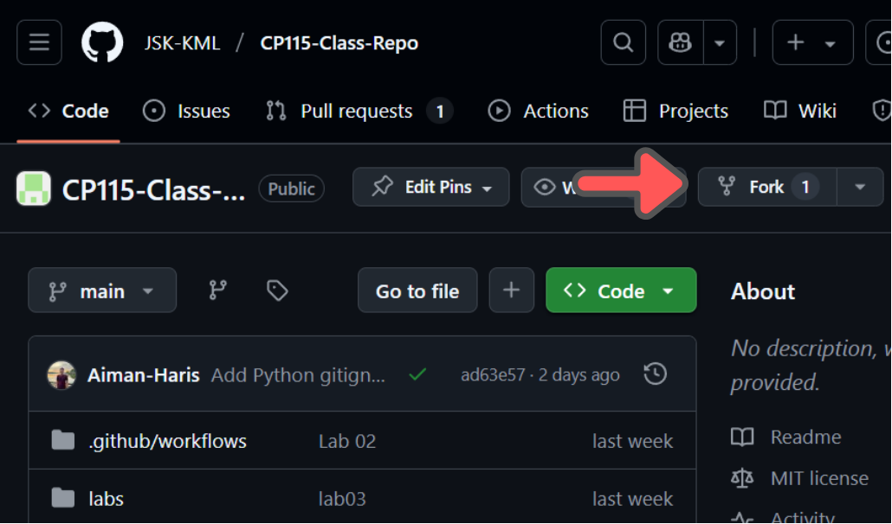
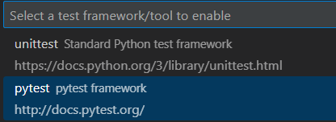

# Pre-Lab: Set Up Your Development Environment and Revision

In this pre-lab you set up **Git**, **VS Code** and **Python**, and get your own copy of the `CP125-Class-Repo` from **GitHub** onto your computer. Everything is done from the terminal with **Git Bash**, using Linux commands, the same way professional developers work.

Read the explanations, then do what each box says:

<Action type="do" title="Action">

A box like this is something you **do**: a command to run or a button to click.

</Action>

<Check>

A green box like this shows what you **should see** if it worked. Check it before moving on.

</Check>

<Checklist title="Before you start" color="blue">

- A **GitHub** account that you can log in to
- **Python**, **Git** (which includes **Git Bash**) and **VS Code** installed

</Checklist>

<YourDetails />

## Install the Python Extension

If **Git** or **VS Code** isn't installed yet, follow the [**Git** installation guide](/labs/installation#git) and the [**VS Code** installation guide](/labs/installation#vs-code) first.

<Action type="do">

In **VS Code**, open the `Extensions` panel, search for **Python** and install the extension from **Microsoft**.

</Action>

<p align="center">
    
</p>

## Open Git Bash in VS Code

In this course everyone uses **Git Bash** as the terminal. It runs Linux commands such as `cd`, `ls`, `mkdir` and `pwd`, which are the same commands you will find in almost every online guide. On Windows, **VS Code** opens **PowerShell** by default, so switch it once.

<Action type="do">

Press `Ctrl` + `Shift` + `P`, type `Terminal: Select Default Profile` and choose `Git Bash`.

</Action>

<Action type="do">

Open a terminal: click `Terminal` → `New Terminal`.

<p align="center">
    
</p>

</Action>

<Check>

A terminal at the bottom of **VS Code** with a prompt ending in `$`, and `bash` shown as the terminal type.

<p align="center">
    
</p>

</Check>

## Fork the Class Repository

When you <Term title="Fork" def="A full copy of someone else's repository under your own GitHub account, still linked to the original.">fork</Term> a repository on **GitHub**, you create a copy of it under your own account. The original stays with its owner; your fork is yours to change.

<Action type="do">

Open the [`CP125-Class-Repo`](https://github.com/JSK-KML/CP125-Class-Repo) on **GitHub**, click `Fork`, keep the default options and click `Create fork`.

<p align="center">
    
</p>

</Action>

<Check>

The page now shows **GITHUB-USERNAME/CP125-Class-Repo**, with *forked from JSK-KML/CP125-Class-Repo* under it.

</Check>

<Accordion>
<AccordionItem title="What is the difference between forking and simply copying?">

When you copy-paste something like a PDF document, you have no connection to the original, so if the original changes you will not know.

A fork stays connected to the original repository. When the original gets updates, **GitHub** tells you and you can bring them into your fork.

</AccordionItem>
</Accordion>

## Log In to GitHub

Before **Git** can push to your fork, **GitHub** needs to know that you are its owner. The **GitHub CLI** (`gh`), already installed on your computer, handles the login. After that, every `git` command uses it automatically.

<Action>

```bash
gh auth login
```

</Action>

<Action type="do" title="Answer the questions">

Use the arrow keys and `Enter`:

- Where do you use GitHub? → `GitHub.com`
- Preferred protocol for Git operations? → `HTTPS`
- Authenticate Git with your GitHub credentials? → `Yes`
- How would you like to authenticate? → `Login with a web browser`

Then copy the one-time code shown (like `ABCD-1234`), press `Enter` to open the browser, paste the code and click `Authorize`.

</Action>

<Check>

```
✓ Logged in as GITHUB-USERNAME
```

</Check>

Every commit you make is labelled with a name and email. Set yours once:

<Action>

```bash
git config --global user.name "GITHUB-USERNAME"
git config --global user.email "GITHUB-EMAIL"
```

</Action>

::: warning On a shared lab computer
Log out before you leave, so the next student can't push to your fork:

```bash
gh auth logout
```
:::

## Create Your Course Folder

Keep all your CP125 work in one folder named after you. You'll make it from the terminal:

| Command | What it does |
|---|---|
| `cd ~` | Go to your home folder |
| `mkdir NAME` | Make a new folder called `NAME` |
| `cd NAME` | Go into the folder `NAME` |
| `pwd` | Print the folder you are in now |

<Action>

```bash
cd ~
mkdir YOURNAME-CP125
cd YOURNAME-CP125
pwd
```

</Action>

<Check>

The last line printed ends with your folder:

```
/c/Users/.../YOURNAME-CP125
```

</Check>

## Clone Your Fork

Your fork only exists on **GitHub**'s servers. To <Term title="Clone" def="Download a repository from GitHub to your own computer, keeping its full history and its link to GitHub.">clone</Term> it is to download it into your course folder, so you can edit and run the code on your computer.

Make sure the terminal is still inside `YOURNAME-CP125`, then:

<Action>

```bash
git clone https://github.com/GITHUB-USERNAME/CP125-Class-Repo.git
cd CP125-Class-Repo
ls
```

</Action>

<Check>

`ls` lists the repository's contents, including the `labs` folder and `README.md`. Your folders now look like this:

```
YOURNAME-CP125/
└── CP125-Class-Repo/
    ├── labs/
    └── README.md
```

</Check>

Now open the repository in **VS Code**. The `.` means "the folder I'm in now":

<Action>

```bash
code .
```

</Action>

<Check>

A **VS Code** window opens with `CP125-CLASS-REPO` at the top of the `Explorer` sidebar. Open a new terminal in this window (`Terminal` → `New Terminal`); it starts inside `CP125-Class-Repo`.

</Check>

## Make Your First Commit and Push

Two **Git** actions get your work onto **GitHub**:

- A <Term title="Commit" def="A saved snapshot of your changes in your local repository, with a unique ID and a message.">commit</Term> records a snapshot of your changes on your computer, with a message explaining what changed. You can go back to any commit later.
- A <Term title="Push" def="Send your new commits from your computer up to your repository on GitHub.">push</Term> sends your new commits up to your fork on **GitHub**.

Let's try it with a tiny file. `echo` prints text, and `>` writes that text into a file instead of the screen:

<Action>

```bash
echo 'print("Hello, CP125")' > labs/lab01/hello.py
python labs/lab01/hello.py
```

</Action>

<Check>

```
Hello, CP125
```

</Check>

Now see what **Git** noticed, then commit and push it:

<Action>

```bash
git status
```

</Action>

<Check>

`labs/lab01/hello.py` listed under *Untracked files*, in red. **Git** sees the new file but isn't saving it yet.

</Check>

<Action>

```bash
git add labs/lab01/hello.py
git commit -m "Add hello.py"
git push
```

</Action>

<Check>

The last line of `git push` looks like `main -> main`.

</Check>

| Command | What it does |
|---|---|
| `git status` | Show which files have changed |
| `git add FILE` | Choose a change to include in the next commit (`git add .` = everything) |
| `git commit -m "..."` | Save a snapshot with a message |
| `git push` | Send your commits to **GitHub** |

<Action type="do">

Open `github.com/GITHUB-USERNAME/CP125-Class-Repo` in the browser and refresh it.

</Action>

<Check>

Your commit message **Add hello.py** next to the `labs` folder, and `hello.py` inside `labs/lab01`.

</Check>

## Sync Your Fork {#syncing-your-fork}

When the original `CP125-Class-Repo` gets new labs, your fork on **GitHub** shows a message like *"This branch is X commits behind"*. Bring the new work into your fork first, then <Term title="Pull" def="Download new commits from your repository on GitHub into the copy on your computer.">pull</Term> it down to your computer.

<Action type="do">

On your fork's page on **GitHub**, click `Sync fork` → `Update branch`.

</Action>

<Action>

```bash
git pull
```

</Action>

<Check>

Either a list of new files and `Fast-forward`, or `Already up to date.` if there was nothing new.

</Check>

## Create a Virtual Environment

A <Term title="Virtual environment" def="A private copy of Python for one project, so the packages you install here don't affect any other project.">virtual environment</Term> is a private copy of **Python** just for this repository. Packages you install inside it don't affect anything else on the computer.

Make sure the terminal is inside `CP125-Class-Repo` (check with `pwd`), then create it:

<Action>

```bash
python -m venv cp125_env
```

</Action>

<Check>

A new `cp125_env` folder in the `Explorer` sidebar.

</Check>

Creating it isn't enough; you have to switch it on (**activate** it) every time you open a new terminal:

<Action>

```bash
source cp125_env/Scripts/activate
```

</Action>

<Check>

`(cp125_env)` at the start of your terminal prompt.

</Check>

<Action>

```bash
python --version
git status
```

</Action>

<Check>

Your **Python** version, like `Python 3.13.1`. `git status` should **not** list `cp125_env`; the repository already tells **Git** to ignore it.

</Check>

## Run a Small Program

<Action type="do">

In **VS Code**, create `labs/lab01/test_virtual_env.py` and paste this in, using your own name and ID:

```python
student_name = "Your Name"
student_id = "Your ID"
course_code = "CP125"

print(student_name)
print(student_id)
print(course_code)
```

</Action>

<Action>

```bash
python labs/lab01/test_virtual_env.py
```

</Action>

<Check>

Your name, your ID and `CP125`, each on its own line.

</Check>

## Install pytest

**pytest** is the testing framework we use to check your lab answers. With the virtual environment active (you see `(cp125_env)`), install it:

<Action>

```bash
python -m pip install pytest
```

</Action>

<Check>

A last line like `Successfully installed ... pytest-8.x.x`.

</Check>

This installs **pytest** only inside `cp125_env`, not on the whole computer.

## Set Up Testing in VS Code

<Action type="do">

In the `Extensions` panel, search for **Python Test Explorer** and install the one by **Little Fox Team**.

<p align="center">
    
</p>

</Action>

<Action type="do">

On the sidebar, click the **flask** icon → **Configure Python Tests** → **pytest** → **Root Directory**.

<p align="center">
    
    
    
</p>

</Action>

::: info Don't see Configure Python Tests?
It only appears once the repository has tests in it. If it isn't there, skip this step for now.
:::

## Finish Up

When you're done, switch the virtual environment off:

<Action>

```bash
deactivate
```

</Action>

<Check>

`(cp125_env)` disappears from the prompt.

</Check>

Next time, open `CP125-Class-Repo` in **VS Code**, open a terminal and run `source cp125_env/Scripts/activate` before you start working.

::: warning On a shared lab computer
Run `gh auth logout` before you leave.
:::
